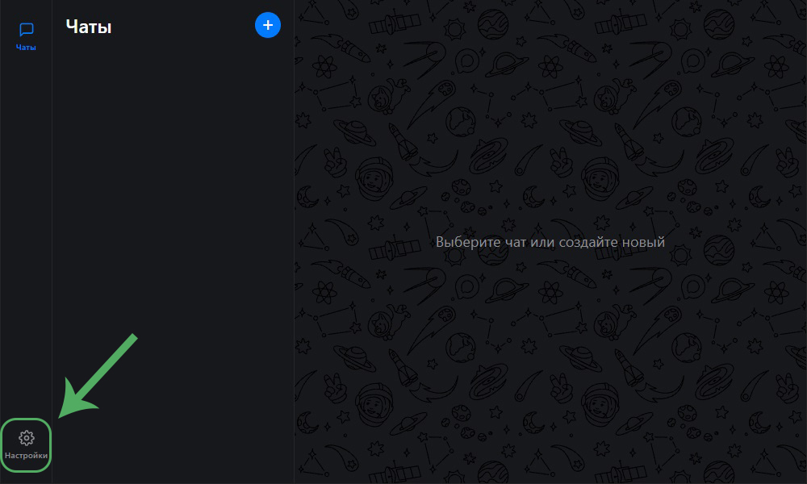
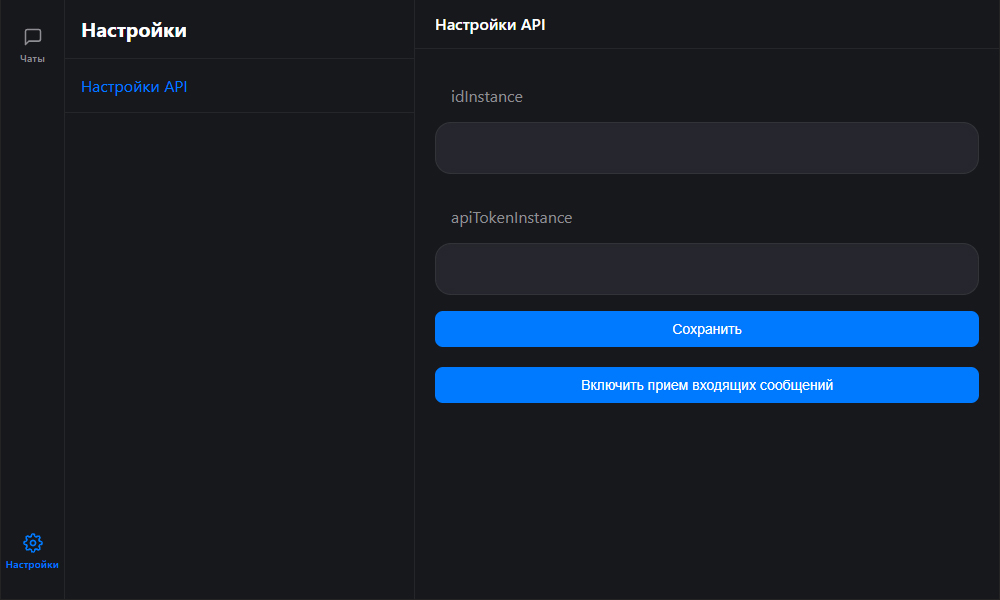
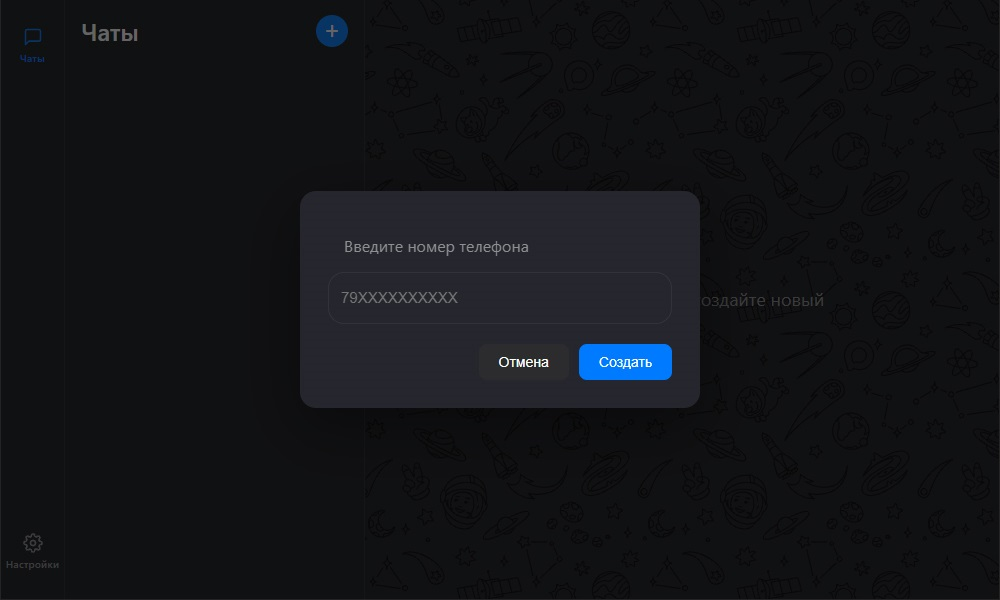
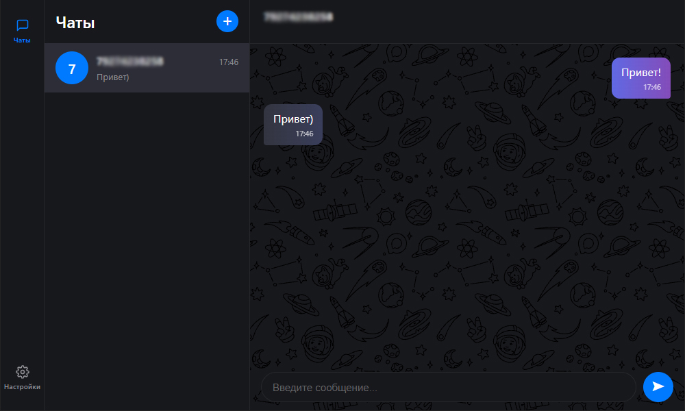

# Переписка в MAX через GREEN-API

Данное приложение - тестовое задание по отработке связи с мессенджером MAX через сервис GREEN-API. Так как цель - только настройка API, приложение максимально простое (только React + TypeScript + Vite без бэкенда).

## Known Issues

Так как проект тестовый, но в нем есть ряд допущений, который, естественно, не годится для боевого проекта, но в данном случае пришлось пойти на такие уступки. А именно:

1. Так как это чистый фронтенд без доступа к бэку, для хранения настроек API, списка чатов и сообщений используется localStorage.

2. Для тестирования использовался бесплатный инстанс GREEN-API, поэтому кол-во абонентов было ограничено тремя получателями. И так вышло, что все они были созданы через указание номера телефона, а не идентификатора чата, как рекомендуется. Поэтому отправка сообщений происходит через обращение к чату в формате "79876543210@c.us", а прием входящих сообщений - через идентификатор чата. Но в рабочем вариант все, так или иначе, нужно привести к одному формату (использованию идентификатора).

3. Для тестирования лучше вести переписку с другим аккаунтом MAX, а не тем, который был использван для авторизации инстанса - это вызывает путанницу с сообщениями, которые просто попадают в Избранное. При этом исходящие сообщения нормально уходят из приложения в MAX, а вот в обратном направлении - почему-то не принимаются самим GREEN-API.

## Начало работы и запуск

Сначала устанавливаем зависимости через команду:

```
npm instal
```

Далее запускаем через:

```
npm run dev
```

Запущенное приложение можно открыть в браузере по адресу `http://localhost:5173/`

## Первичная настройка

Чтобы начать пользоваться приложением, нужно настроить связь с сервисом GREEN-API. Для этого переходим в настройки в нижнем левом углу.



После этого указываем `idInstance` и `apiTokenInstance`, узнать которые можно в настройках вашего инстанса в личном кабинете GREEN-API. Далее жмем "Сохранить".



Потом жмем на кнопку "Включить прием входящих сообщений" - это настроит нужные параметры инстанса. После этого ОБЯЗАТЕЛЬНО переходим в личный кабинет и перезапускаем инстанс, потому как только после этого применяются изменения (даже при ручной настройке в личном кабинете).

## Создание чата и переписка

Далее создаем новый чат через синий плюсик в верху экрана. Номер телефона нужно указать в формате "79876543210".



После этого можно писать сообщения. Входящие сообщения из мессенджера MAX будут отображаться в чате после приема GREEN-API.


